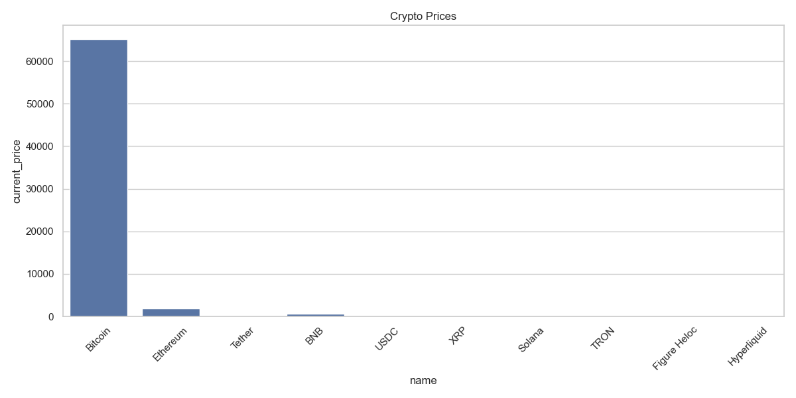
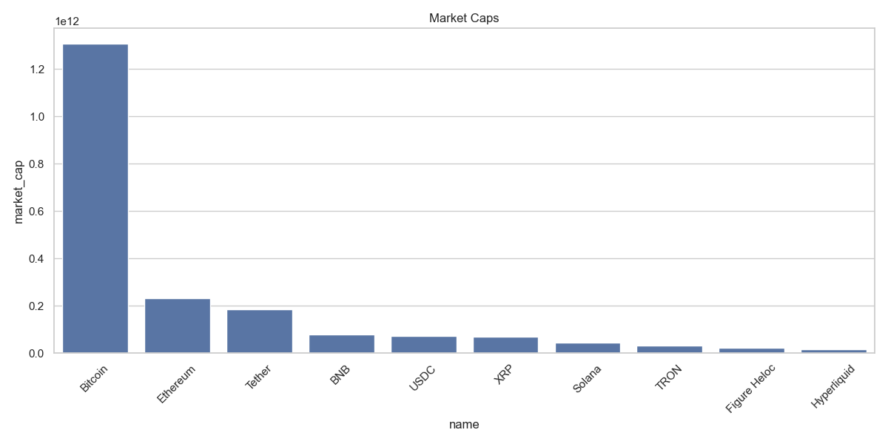
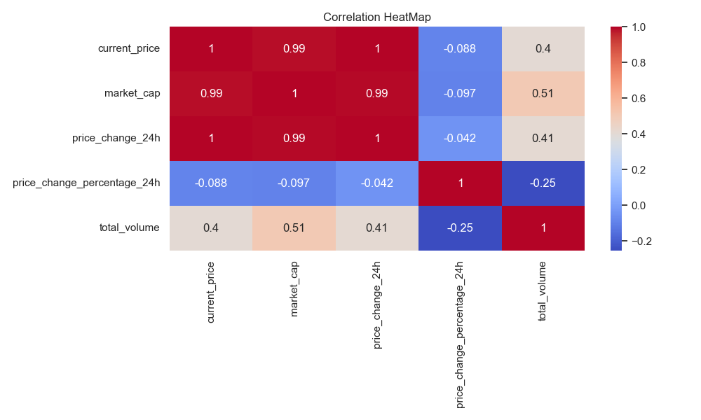

📊 Crypto Data Explorer
A python project which fetches the live crypto data, cleans it, analyse it using Pandas and Numpy, ans visualize using matplotlib and Seaborn.

🚀 Features
1. Live data fetching from CoinGecko API
2. Data Cleaning + JSON export
3. Pandas DataFrame Analysis
4. Numpy numerical Analysis (returns, volatility, risk score)
5. Visualizations
6. Full Pipeline + interactive Menu
7. Professional Project Structure

📁 Project Structure
src/
   cryptofetcher.py
   panda_analysis.py
   numpy_analysis.py
   visualizations.py
   main.py
clean_crypto_data.json
crypto_data.csv
requirements.txt
README.md
Screenshots/

📈 Visualizations
 
 
 

🧠 Technologies Used
1. Python
2. Pandas
3. Numpy
4. Matplotlib
5. Seaborn
6. CoinGecko API

▶️ How to Run
pip install -r requirements.txt
python src/main.py

📬 Author
Harmanpreet kaur -- Crypto Data Explorer Project